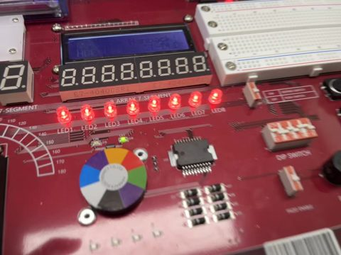
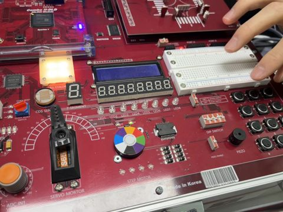
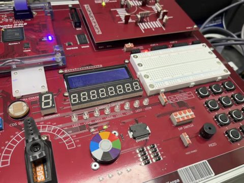
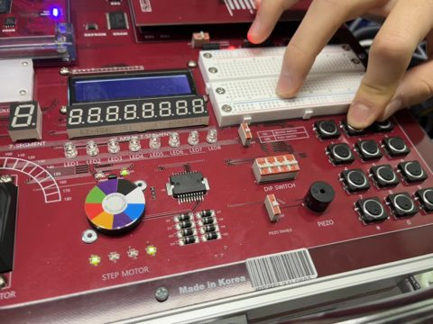
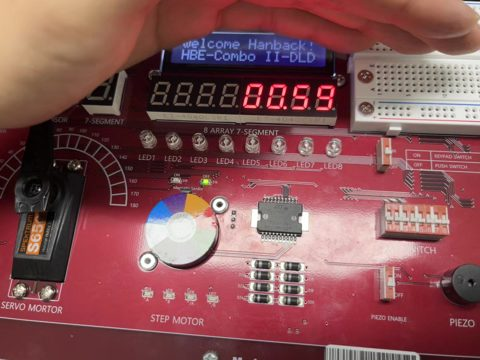
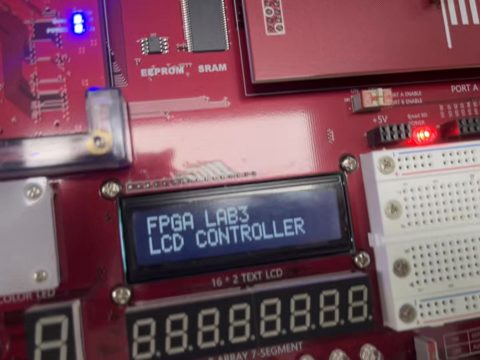
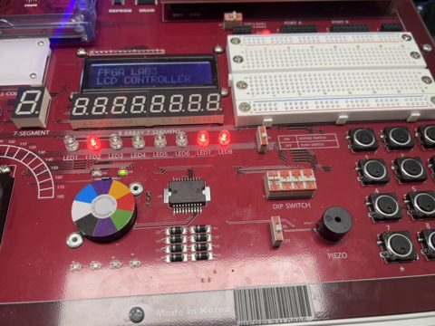

# LAB 3 보드 실험 영상

HBE-Combo II-DLD(Spartan-7 xc7s75fgga484-1) 보드에 `lab3/lab3_0N_*/`의 bitstream을 기록한 뒤 촬영한 영상이다.
썸네일이나 파일 이름을 누르면 영상이 열린다. **LAB3-07 UART 에코가 실습 시간에 조교에게 시연한 실험이다.**

| 실험 | 영상 | 입력 조건 | 영상에서 확인한 동작 |
|---|---|---|---|
| LAB3-01 PWM LED |  [lab3_01_led_pwm.mp4](lab3_01_led_pwm.mp4) | 버튼을 반복해서 누름 | LED1–8이 함께 단계적으로 밝아지고, 최대 밝기 다음 누름에서 꺼진 뒤 다시 어두운 단계부터 밝아진다. |
| LAB3-02 RGB LED PWM |  [lab3_02_rgb_pwm.mp4](lab3_02_rgb_pwm.mp4) | R·G·B 버튼을 각각 누름 | Full Color LED의 색이 누른 채널에 따라 빨강, 노랑 계열, 흰색 계열로 바뀐다. |
| LAB3-03 피에조 |  [lab3_03_piezo.mp4](lab3_03_piezo.mp4) | PIEZO 스위치를 ON으로 올림 | 스위치를 올린 약 0.75초 지점부터 피에조에서 단일 음이 난다. 영상 음성의 스펙트럼 피크가 294 Hz의 정수배(7–16배)에 놓여 기본 주파수 약 294.0 Hz로 계산값과 일치한다. |
| LAB3-04 스텝모터 |  [lab3_04_stepper.mp4](lab3_04_stepper.mp4) | 버튼으로 구동·방향 입력 | 색 원판이 회전하고 STEP MOTOR 상(相) 표시 LED가 켜진다. |
| LAB3-05 MM:SS 시계 |  [lab3_05_mmss_clock.mp4](lab3_05_mmss_clock.mp4) | 입력 없음(자유 동작) | 7세그먼트 오른쪽 4자리가 00:54에서 1초마다 올라 00:59 다음에 01:00, 01:01이 된다. |
| LAB3-06 문자 LCD |  [lab3_06_character_lcd.mp4](lab3_06_character_lcd.mp4) | 입력 없음(전원·기록 후) | LCD 1행에 `FPGA LAB3`, 2행에 `LCD CONTROLLER`가 표시된다. |
| **LAB3-07 UART 에코 (조교 시연)** |  [lab3_07_uart_echo.mp4](lab3_07_uart_echo.mp4) | PC의 Tera Term(COM5, 9600 8N1)에서 문자 입력 | 입력한 문자가 터미널에 한 번씩 표시되고, LED1–8(LED1 = bit 7)이 마지막 문자의 ASCII 코드로 바뀐다. 영상 후반에 A(0x41)→B→C→D→F→G→H(0x48) 순서로 바뀌는 것이 보인다. |

- 영상은 휴대전화로 촬영한 원본을 브라우저에서 재생되도록 H.264로 다시 인코딩한 것이다.
- LAB3-05 영상은 세로로 촬영되어 화면이 90° 돌아가 있다.
- 결과보고서: [../LAB3_결과보고서.docx](../LAB3_결과보고서.docx) · 렌더링 PDF: [../qa_render/LAB3_결과보고서.pdf](../qa_render/LAB3_결과보고서.pdf)
