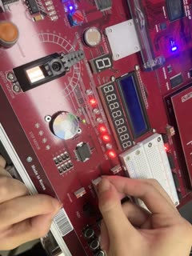
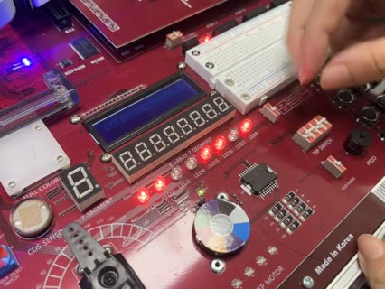
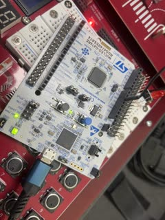
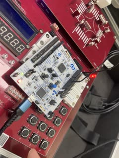

# LAB 4 보드 실험 영상

2026-10-12 실습에서 촬영한 영상 4개다. FPGA 영상은 HBE-Combo II-DLD(Spartan-7 xc7s75fgga484-1)에 `lab4/lab4_0N_*/`의 설계를 기록한 것이고, STM32 영상은 NUCLEO-G474RE에 `lab4/stm32_lab/`의 STM32_0 과제 코드를 내려받은 것이다.
썸네일이나 파일 이름을 누르면 영상이 열린다.

| 실험 | 영상 | 입력 조건 | 영상에서 확인한 동작 |
|---|---|---|---|
| FPGA-01 4비트 곱셈기 |  [lab4_fpga_01_mult_4bit.mp4](lab4_fpga_01_mult_4bit.mp4) (9.7 s) | DIP 스위치를 하나씩 올림 | LED1–8(LED1 = m[7])이 0 → 1 → 3 → 7 → 21 → 77로 바뀐다. 각각 1×1, 3×1, 7×1, 7×3, 7×11의 곱이다. |
| FPGA-02 BCD→이진수 변환 |  [lab4_fpga_02_bcd_conv.mp4](lab4_fpga_02_bcd_conv.mp4) (10.6 s) | DIP 스위치로 십의 자리·일의 자리를 바꿈 | LED2–8(bin[6:0])이 0 → 1 → 3 → 7 → 27 → 67 → 77 → 17 → 7로 바뀌는 동안 LED1(valid)은 켜져 있다. 마지막에 일의 자리가 15가 되면 bin은 15, LED1은 꺼진다. |
| STM32_0 과제1 (내장 LED) |  [lab4_stm32_01_task1_onboard_led.mp4](lab4_stm32_01_task1_onboard_led.mp4) (17.6 s) | 사용자 버튼(파란색)을 1.70 s, 9.70 s에 누름. 디버그 모드, 누름 처리 안에 중단점 | 내장 LED LD2(리셋 버튼과 사용자 버튼 사이의 초록 LED)가 0.90, 5.70, 7.70, 9.70, 16.53 s에 바뀐다. 누를 때마다 중단점에서 약 2.8 s씩 멈췄고(그동안 tick도 정지), 그 시간을 빼면 간격은 1 s → 2 s → 4 s다. 외부 LED는 꺼져 있다. |
| STM32_0 과제2 (외부 LED) |  [lab4_stm32_02_task2_external_led.mp4](lab4_stm32_02_task2_external_led.mp4) (11.8 s) | 사용자 버튼을 3.44 s, 8.08 s에 누름 | PB0의 외부 적색 LED가 0.67, 1.67, 2.67, 4.67, 6.67, 10.63 s에 바뀐다. 간격이 1 s → 2 s → 4 s로 늘어난다. 내장 LED는 꺼져 있다. |

- 시각은 영상을 30 fps 프레임 단위로 읽은 값이고(한 프레임 0.033 s), 버튼을 누른 시각은 영상 음성의 클릭음에서 읽었다. 측정값은 [../data/](../data/)에, 측정 방법은 [../make_figures.py](../make_figures.py)에 있다.
- 영상은 휴대전화로 촬영한 원본(HEVC)을 브라우저에서 재생되도록 H.264로 다시 인코딩하고 이름을 바꾼 것이다.
- FPGA-01, STM32 영상 2개는 세로로 촬영했다.
