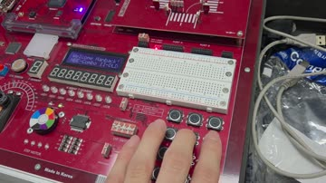
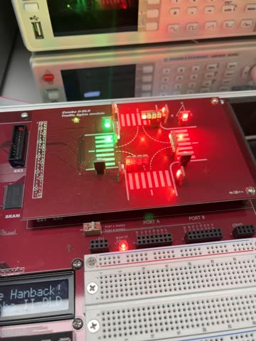
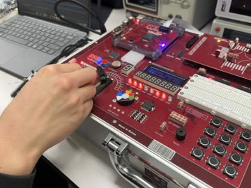
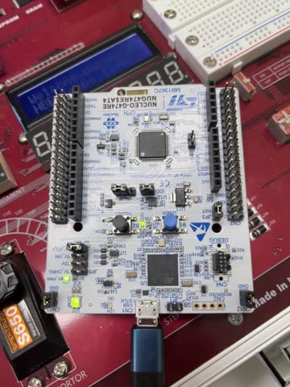
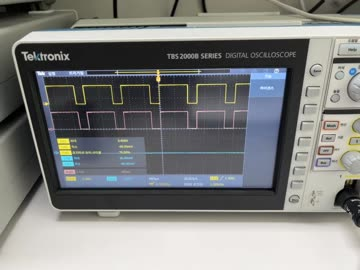

# LAB 5 보드 실험 영상

2026-10-19 실습에서 촬영한 영상 5개다. FPGA 영상은 HBE-Combo II-DLD(Spartan-7 xc7s75fgga484-1)에 `lab5/lab5_0N_*/bitstream/`의 설계를 기록한 것이고, STM32 영상은 NUCLEO-G474RE에 `lab5/stm32_lab/`의 STM32_1 과제 코드를 내려받은 것이다.
썸네일이나 파일 이름을 누르면 영상이 열린다.

| 실험 | 영상 | 입력 조건 | 영상에서 확인한 동작 |
|---|---|---|---|
| FPGA-01 피아노 |  [lab5_fpga_01_piano.mp4](lab5_fpga_01_piano.mp4) (6.0 s, 소리 포함) | 키패드 버튼 8개를 왼쪽부터 하나씩 누름 | 피에조에서 도·레·미·파·솔·라·시·높은 도가 차례로 난다. 녹음된 소리의 고조파로 구한 주파수는 262.00, 294.02, 330.01, 349.04, 392.11, 439.97, 493.94, 523.00 Hz로, 설계값과 0.11 Hz 이내다. |
| FPGA-02 신호등 |  [lab5_fpga_02_traffic.mp4](lab5_fpga_02_traffic.mp4) (18.5 s) | 처음 약 1 s 동안 SW2(flicker)를 누르고 있다가 뗌 | 0.98 s까지 노랑·보행 빨강 점멸. 1.00 s에 서쪽 차량·보행 초록, 4.67 s부터 보행 초록이 0.5 s씩 점멸, 11.17 s에 노랑으로 바뀌고 13.17 s에 동쪽 방향으로 넘어간다. 17.67 s부터 동쪽 보행 초록이 점멸한다. |
| FPGA-03 ADC |  [lab5_fpga_03_adc.mp4](lab5_fpga_03_adc.mp4) (17.8 s) | `adc_board_fix.bit`. 0~4.4 s ch0(CdS) 위에 휴대전화를 댐 → 4.4~5.2 s DIP_SW1로 ch1 선택 → 5.6 s부터 가변저항(ADC IN1)을 돌림 | LED1~8에 ch0은 1110_0010~1110_1110, ch1은 0000_0000에서 1111_1110까지 바뀐다. 채널 전환은 된다. LED8(최하위)은 영상 내내 한 번도 켜지지 않았다(보고서 5장). |
| STM32_1 과제3 (버튼·TIM6 ISR로 LED 간격 변경) |  [lab5_stm32_01_task3_led_interval.mp4](lab5_stm32_01_task3_led_interval.mp4) (13.0 s) | 디버그 모드로 실행. 사용자 버튼(파란색)을 약 1.3~2.2 s, 6.9~7.7 s에 누름 | 내장 LED LD2가 0.80 s 켜짐 → (손가락에 가려진 사이 꺼짐) → 3.90 s 켜짐 → 5.93 s 꺼짐 → 11.40 s 켜짐. 누를 때마다 간격이 1 → 2 → 4 s로 늘었고, 두 번째 누름 뒤에는 약 1.47 s가 더 걸렸다. |
| STM32_1 과제4 (버튼으로 PWM 비율 변경) |  [lab5_stm32_02_task4_pwm.mp4](lab5_stm32_02_task4_pwm.mp4) (6.9 s) | 오실로스코프 CH1(노란색) = PB4. 화면 밖에서 버튼을 누름 | 1 kHz, 최대 3.40 V 파형의 듀티 표시가 50 → 75 → 25 → 50 → 75 %로 바뀐다(2.1, 3.7, 5.2, 6.5 s 무렵). 주기는 1 ms 그대로다. |

- 시각은 영상을 30 fps 프레임 단위로 읽은 값이다(한 프레임 0.033 s). 피아노 주파수는 영상 음성(48 kHz)에서, 신호등·과제3의 변화 시각은 프레임마다 LED 화소를 세어 구했다. ADC LED 값과 오실로스코프 듀티 표시는 장면을 보고 읽었다. 측정값은 [../data/](../data/)에, 측정 방법은 [../make_figures.py](../make_figures.py)에 있다.
- 영상은 휴대전화로 촬영한 원본(HEVC)을 브라우저에서 재생되도록 H.264로 다시 인코딩하고 이름을 바꾼 것이다.
- 신호등과 과제3 영상은 세로로 촬영했다. 오실로스코프 화면의 분홍색 파형(Math)은 측정에 쓰지 않았다.
