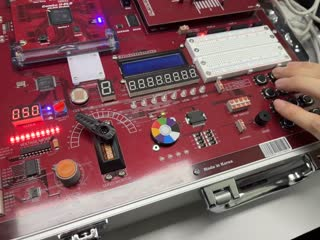
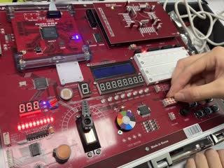
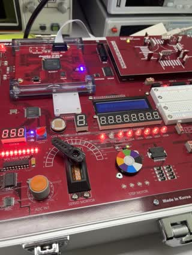
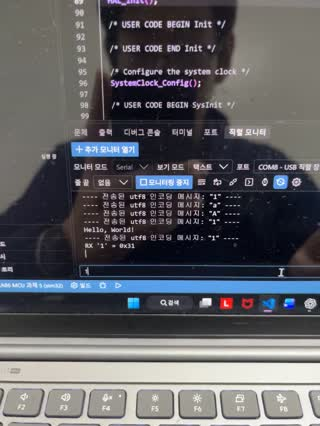
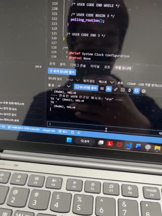
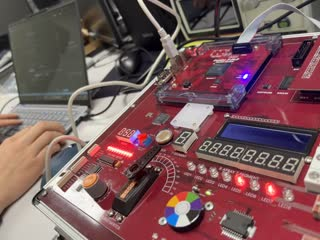

# LAB 6 보드 실험 영상

2026-10-26 실습에서 촬영한 영상 6개다. FPGA 영상은 HBE-Combo II-DLD(Spartan-7 xc7s75fgga484-1)에 `lab6/lab6_0N_*/bitstream/`의 설계를 기록한 것이고(서보는 `servo_board_mul.bit`), STM32 영상은 NUCLEO-G474RE에서 STM32_2 과제 5·6·7을 실행한 것이다. 과제 6·7의 FPGA 쪽은 `lab6_04_uart_led/bitstream/mcu_uart_led.bit`다.
썸네일이나 파일 이름을 누르면 영상이 열린다.

| 실험 | 영상 | 입력 조건 | 영상에서 확인한 동작 |
|---|---|---|---|
| FPGA-01 서보모터 |  [lab6_fpga_01_servo.mp4](lab6_fpga_01_servo.mp4) (5.2 s, 소리 포함) | SW2(왼쪽)·SW3(오른쪽)을 약 0.17 s 간격으로 연달아 누름 | 팔이 가운데(약 90°) → 왼쪽 끝(약 45°) → 가운데 → 오른쪽 끝(약 135°) → 가운데 → 약 63°로 움직인다. 클릭음 다섯 번마다 끝과 가운데를 오가, 한 번에 0.1 ms(약 9°)씩, 1~2 ms 범위에서 멈추는 설계와 맞는다. |
| FPGA-02 SRAM |  [lab6_fpga_02_sram.mp4](lab6_fpga_02_sram.mp4) (12.0 s) | DIP로 주소·데이터 설정 → SW2(쓰기) → DIP 변경 → SW3(읽기), 두 번 반복 | 쓰기 중에는 LED가 꺼져 있고, 읽기 버튼을 누르는 동안만 LED5~8에 저장된 값이 나온다. 첫 번째 읽기 0000_0011, 두 번째 읽기 0000_0010. |
| FPGA-03 DAC |  [lab6_fpga_03_dac.mp4](lab6_fpga_03_dac.mp4) (3.9 s) | 입력 없이 촬영 | LED1~8의 값이 초당 약 100씩(100.2, 98.8, 99.7) 늘고 1.73 s에 255에서 0으로 돌아간다. LED1(MSB)은 0.47~1.73 s 동안 켜져 있다. 전압계 막대는 0 근처에서 꺼졌다가 약 0.5 s 만에 가득 찬다. 2.80~2.93 s에는 모든 LED가 꺼진 뒤 0부터 다시 센다. |
| STM32_2 과제5 (PC ↔ MCU) |  [lab6_stm32_01_task5_uart_echo.mp4](lab6_stm32_01_task5_uart_echo.mp4) (12.6 s) | 직렬 모니터(COM8, 9600, 줄 끝 없음)에서 `1`, `1`, `a`, `A` 전송 | 리셋 뒤 `Hello, World!`, 이어서 받은 문자마다 0x31, 0x31, 0x61, 0x41이 한 줄씩 출력된다. |
| STM32_2 과제6 (PC → MCU → FPGA → PC) |  [lab6_stm32_02_task6_mcu_fpga.mp4](lab6_stm32_02_task6_mcu_fpga.mp4) (9.3 s) | MCU 포트(COM8, 줄 끝 LF)에 `1`, `a`, `A`. FPGA USB-UART는 다른 PC의 직렬 모니터로 봄 | MCU는 문자와 LF를 하나씩 UART3로 보내고 결과 0(HAL_OK)을 출력한다. FPGA 포트에는 1, a, A가 한 줄씩 들어온다. |
| STM32_2 과제7 (UART 명령으로 LED) |  [lab6_stm32_03_task7_led_cmd.mp4](lab6_stm32_03_task7_led_cmd.mp4) (5.6 s) | MCU 포트에 `0`, `1`, `0`(줄 끝 LF) | LED2~8이 0.50 s에 `'0'`, 2.30 s에 `'1'`, 4.17 s에 `'0'`을 한 프레임 보이고 곧 LF(000_1010)로 바뀐다. LED1은 2.30 s에 켜지고 4.20 s에 꺼진다. LF 뒤에도 LED1은 그대로다. |

- 시각은 영상을 30 fps 프레임 단위로 읽은 값이다(한 프레임 0.033 s). DAC와 과제7의 LED 상태는 프레임마다 LED 위치의 빨간 화소를 세어 구했다(손떨림은 기준 프레임과의 이동량으로 보정). 서보 버튼은 영상 음성의 클릭음으로 찾았다. 서보 팔 각도, SRAM LED 값, 직렬 모니터 글자는 장면을 보고 읽었다. 측정값은 [../data/](../data/)에, 측정 방법은 [../make_figures.py](../make_figures.py)에 있다.
- 영상은 휴대전화로 촬영한 원본(HEVC)을 브라우저에서 재생되도록 H.264로 다시 인코딩하고 이름을 바꾼 것이다.
- DAC, 과제5, 과제6 영상은 세로로 촬영했다. DAC 영상의 각도 눈금 위 서보 팔은 이 실험과 관계없다.
