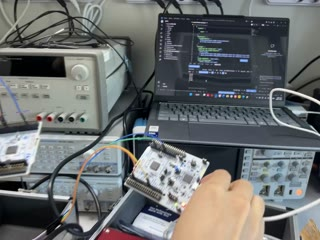
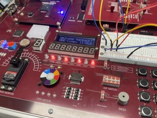
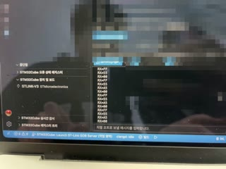
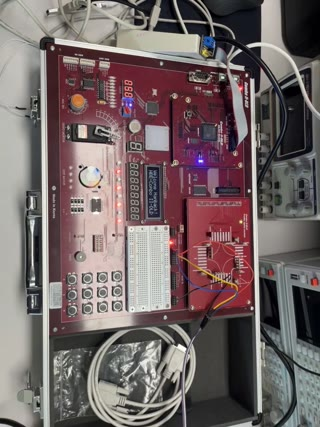

# LAB 7 보드 실험 영상

2026-11-02 실습(STM32_3 SPI, 과제 8~12)에서 촬영한 영상 4개와 오실로스코프 사진이다. MCU는 NUCLEO-G474RE에서 `lab7/stm32_lab`을 `STM32_3_ROLE=1`(송신) 또는 `2`(수신)로 빌드해 올렸고, FPGA는 HBE-Combo II-DLD(Spartan-7 xc7s75fgga484-1)에 `lab7/lab7_01_spi_rx/bitstream/spi_rx_uart.bit`(수신) 또는 `lab7/lab7_02_spi_tx/bitstream/spi_tx_uart.bit`(송신)를 올렸다. 보내는 값은 MCU와 FPGA 모두 1초마다 0x55 → 0xA5 → 0x00 → 0xFF 순서다.
썸네일이나 파일 이름을 누르면 영상이 열린다.

| 실험 | 영상 | 입력 조건 | 영상에서 확인한 동작 |
|---|---|---|---|
| 과제9 MCU → MCU |  [lab7_stm32_01_task9_mcu_to_mcu.mp4](lab7_stm32_01_task9_mcu_to_mcu.mp4) (7.2 s) | 송신 NUCLEO(ROLE=1) D3·D11·D10 → 수신 NUCLEO(ROLE=2) D3·D11·A2, GND 공통 | 수신 보드의 직렬 모니터(COM8)에 RX=00, FF, 55, A5, 00이 한 줄씩 차례로 찍힌다. |
| 과제10 MCU → FPGA |  [lab7_fpga_01_task10_mcu_to_fpga.mp4](lab7_fpga_01_task10_mcu_to_fpga.mp4) (4.6 s) | NUCLEO(ROLE=1) D3·D11·D10 → FPGA 수신 BDIO_0~2, DIP SW5 켬 | FPGA LED1~8이 FF → 55 → A5 → 00으로 바뀐다. 바뀐 시각은 0.20 s, 1.17 s, 2.17 s로 간격 0.97 s, 1.00 s다. |
| 과제11 FPGA → MCU |  [lab7_fpga_02_task11_fpga_to_mcu.mp4](lab7_fpga_02_task11_fpga_to_mcu.mp4) (11.5 s) | FPGA 송신 BDIO_0~2 → NUCLEO(ROLE=2) D3·D11·A2 | MCU 직렬 모니터에 RX=00, FF, 55, A5가 순서대로 반복해 찍히고, 타임아웃이나 오류 줄은 없다. FPGA LED에는 보내는 값이 보인다. |
| 과제12 FPGA → FPGA |  [lab7_fpga_03_task12_fpga_to_fpga.mp4](lab7_fpga_03_task12_fpga_to_fpga.mp4) (9.7 s) | 송신 보드(화면 위쪽)와 수신 보드(아래쪽)의 BDIO_0~2를 같은 번호끼리, GND 공통 | 송신·수신 보드의 LED가 A5(6.0 s) → 00(6.5~7.0 s) → FF(7.5~8.0 s) → 55(8.5~9.0 s)로 같이 바뀐다. |

과제 8(MCU 송신 파형)은 영상 대신 오실로스코프 화면 사진으로 남겼다.

| 사진 | 채널 | 읽은 값 |
|---|---|---|
| [scope_sck_mosi.jpg](../images/scope/scope_sck_mosi.jpg) | CH1 MOSI, CH2 SCK, 4 µs/div | SCK 786.2 kHz, MOSI 391.2 kHz(0x55 = 0101_0101) |
| [scope_cs_sck.jpg](../images/scope/scope_cs_sck.jpg) | CH1 CS, CH2 SCK, 4 µs/div | SCK 8펄스, CS LOW → 첫 SCK 약 3.0 µs, CS LOW 약 15.8 µs |

- 시각은 영상을 30 fps 프레임 단위로 읽은 값이다(한 프레임 0.033 s). 과제10의 바뀐 시각은 프레임마다 LED1~4 위치의 빨간 화소로 구했다. 직렬 모니터 글자와 과제12의 LED 값은 장면을 보고 읽었다. 오실로스코프의 주파수는 계측기의 자동 측정값이고, 시간 간격은 화면 사진의 화소 위치를 SCK 주기에 맞춰 읽었다(약 ±0.3 µs). 측정값은 [../data/](../data/)에, 측정 방법은 [../make_figures.py](../make_figures.py)에 있다.
- 영상은 휴대전화로 촬영한 원본(HEVC)을 브라우저에서 재생되도록 H.264로 다시 인코딩하고 이름을 바꾼 것이다. 과제9·11 영상은 노트북 화면에 비친 얼굴을 모자이크했다([../blur_faces.py](../blur_faces.py)). 과제12 영상은 세로로 촬영했다.
